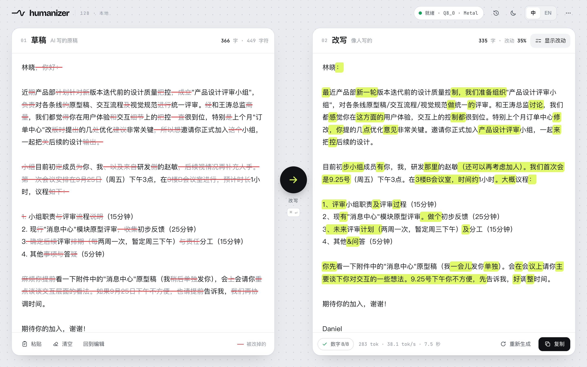
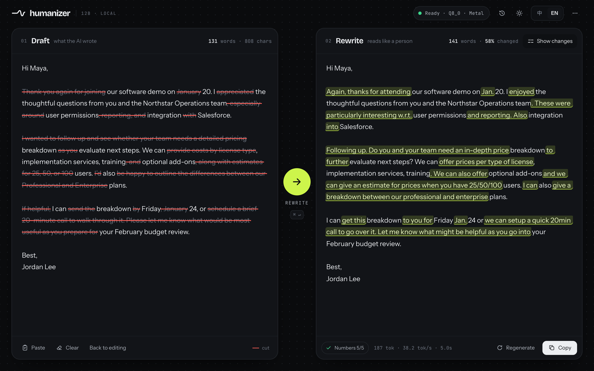

# Humanizer App

把 humanizer 改写模型做成一个双击就能用的本地网页 App:第一次打开自动按内存选档、下载 GGUF,之后完全离线。左边贴 AI 写的草稿,右边流式出改写,改完用荧光笔标出新写的部分、在原稿上划掉被改掉的部分。

| 改写完成(中文 · 浅色) | 改写完成(English · dark) |
|---|---|
|  |  |

更多:`docs/screenshots-real/` 里还有 `editor-en-light.png`、`editor-zh-dark.png`、`mobile-en-light.png`。
这些是 /Applications/Humanizer.app 加载 12B 的 llama.cpp Q8_0 GGUF(Metal,M5 Max)真机实拍,底栏里的速度是真实的。

---

## 用户视角

1. 下载 `Humanizer-<版本>-macos-arm64.dmg`(Apple 芯片)或 `Humanizer-<版本>-windows-x64-setup.exe`(或便携 zip)。
2. 双击 Humanizer → 浏览器自动打开 `http://127.0.0.1:47615/`。
3. 第一次:页面显示本机内存和推荐档位,点「下载」。断网、关页面、退出 App 都能续传;下完校验 sha256,自动装载。
4. 之后每次双击都直接进编辑器。App 没有窗口、也不在 Dock / 任务栏里;退出在网页右上角「…」菜单。网页关掉 30 分钟后 App 自动退出、释放内存。

### 没有签名时的系统拦截(目前就是这样)

- **macOS**:没有 Apple Developer ID,首次打开会提示「无法验证开发者 / 无法确认没有恶意软件」。处理:双击一次后去「系统设置 → 隐私与安全性」点「仍要打开」;或终端执行 `xattr -dr com.apple.quarantine /Applications/Humanizer.app`。dmg 里附了一份《打不开怎么办.txt》。macOS 15 起右键「打开」已经绕不过去,只能走系统设置。
- **Windows**:安装包没签名,SmartScreen 会弹「Windows 已保护你的电脑」,点「更多信息 → 仍要运行」。下载量少的新签名证书也会被 SmartScreen 拦一段时间,只有 EV 证书或 Azure Trusted Signing 能比较快消掉。

---

## 架构

```
浏览器 (web/, 纯静态,无 CDN)
   │  http://127.0.0.1:47615   (固定端口:localStorage 按端口隔离,端口不变历史才不丢)
   ▼
启动器 (Go 单文件,网页和默认配置编译进去)
   ├─ /           静态网页
   ├─ /app/*      状态、选档、下载暂停/继续、重启引擎、退出
   └─ /api/*  ──► 反代(白名单 completion/tokenize/detokenize/health/props,自动带上引擎密钥)
                    │
                    ▼
               llama-server (随包附带,随机端口,只听 127.0.0.1,-ngl all)
```

- **提示词**:`INSTR + "\n\n" + draft.strip() + "\n\n### Rewritten:\n\n"`,字符串只在 `internal/launcher/prompt.go` 一处;Go 单测把它钉在 `humanizer/promptfmt.py` 的指纹 `cc51d66b4c593fbe` 上。网页从 `/app/config` 拿到字符串后自己拼,并用启动器给的 `probe`(=拼 `"X"` 的结果)逐字自检,对不上就拒绝改写。`draft.strip()` 在 JS 里按 Python 的空白定义复刻(比 JS `trim` 多 `\x1c-\x1f`、`\x85`,少 ``)。
- **采样**:`temperature 1.0, top_p 0.95`,另外显式关掉 llama-server 默认开着的 `top_k=40 / min_p=0.05 / repeat_penalty`(设成 0/0/1.0),和评测时的 vLLM 行为一致。只靠 EOS 停,不传 `stop`。`n_predict = min(2048, max(256, ceil(草稿 token × 2.5)))`,草稿 token 数用 `/tokenize`(不加 BOS)算。流式 `stream: true`,`return_progress` 用来显示「读稿中 xx%」。
- **语言保险**(0.3.1):英文草稿偶尔会被整篇写成中文(夹技术术语的口语短稿上偶发,和档位无关)。`web/js/guard.js` 只数汉字:草稿汉字 ≤2 而输出汉字 >15,流式途中当场掐掉、同样参数静默重采,最多 3 次,第 4 次照常交出;反方向(中文草稿写成英文)只在写完后判。阈值和 `humanizer/hz_text.py` 的 `language_drift` 一致。
- **导入 .docx / .pdf**(0.3.2,外部贡献 PR #2):草稿底栏「导入」或把文件拖到草稿上。网页把文件 POST 到 `/app/document`(同样要带 `X-Humanizer` 头),启动器在内存里提取文字、不落盘,最大 20 MB、500 页、2 MB 文字。DOCX 只取正文段落和表格(页眉页脚、批注、图片不要),段落之间空一行,和模型训练时草稿的分段一致;表格一行一行、单元格用 Tab 隔开。PDF 由 `github.com/ledongthuc/pdf` 解析文件结构,解码和排版在 `document_pdf.go` 自己做:库只在 Identity-H 时才用 ToUnicode,Chrome / Skia 打印的中文 PDF(Type3 字体 + Differences + ToUnicode)会整篇乱码;库按文字对象一行一换行,英文段落会被切碎。这里只要有 ToUnicode 就用,按文字矩阵算坐标拼行,行距明显变大、字号变化、上一行是短句收尾才分段,没写满又不是句末的短行(落款、地址、列表项)保留换行,段内英文行用空格接回、中文行直接接上;再把 Chrome 写成部首码位的字(⼀ U+2F00、⻋ U+2ECB 等,对照表来自 Unicode EquivalentUnifiedIdeograph.txt)和连字 fi 归一。控制字符/替换符/私用区字符超过 5% 就报「编码认不出来」,不把乱码塞进草稿。扫描版 PDF 没有文字层,提示先 OCR。提取期间草稿被改过就不覆盖。
- **长文档提示**(0.3.2):草稿估算超过约 1,000 token(≈ 700 个英文词 / 1,100 个汉字,`text.js` 的 `LONG_DRAFT_TOKENS`)时,草稿框底部显示一条提示:长文档改写可能出现事实偏差,建议检查结果,或让 AI 把改错的地方纠正一下。门槛的依据:评测集最长的草稿约 450 词;草稿过了约 820 token,输出就顶到 n_predict 上限 2,048。
- **长文分段改写**(0.3.4,外部贡献 PR #5):草稿 token × 2.5 超过单次输出上限 2,048(约 820 token 以上,也就是以前提示「结尾可能被截断,建议分段」的那条线),或提示词 + 输出放不进上下文时,自动分段改写;更短的草稿走原来的单篇流程,一点不变。切分在 `web/js/document.js`:先把原样保留的文字换成占位符(和单篇同一套),占位符是原子,任何切点都不落在里面;切点优先级 空行 → 换行 → 句末(含中文句号和后面的引号)→ 分句标点 → 空白 → 按字硬切(不切开代理对);相邻小块合并成大致等长的段,每段目标约 560 token(≈ `hz` 的 350 英文词 / 600 汉字),先按字数估算,再用 `/tokenize` 实数,超过 760 的按实测比例再切。段与段之间原文的空白(空行、缩进)原样保留,拼回去和原稿逐字一致。每段走和单篇完全相同的 `generate()`:同一提示词、同一采样,语言保险和 Create fact 核对/重试都按段做;只有完整(EOS 结束、没被截断)、非空、带齐本段保留文字的结果才算完成。改写区上方有进度条;改写中草稿框只读(停止后恢复)。每完成一段,断点(草稿、保留段、各段原文和已完成的结果、模型档位 + 提示词 + 采样的签名)存进 localStorage 的 `hz.document`;点「停止」、出错或刷新页面后,点「继续改写」或 ⌘↵ 从没完成的那段接着改,已完成的段不再送进引擎。草稿或保留段一改,断点作废;换了档位/设置,只能「重新开始」。存不进 localStorage(满了、无痕、被禁用)时照常改写,只提示进度只在这个页面里。全部完成后结果按原文空白拼好,和单篇一样进历史(多记一个段数),可以复制,也可以「下载」成 UTF-8 `.txt`(单篇结果同样能下载)。各段分开改写,段与段的衔接、数字和人名要人看一遍,完成提示里会说。
- **外部模型服务**(0.3.4,HF 讨论 #11):「…」→「外部模型服务」(选档页下面也有入口)。打开后启动器不拉起自带 llama.cpp、暂停未完成的下载(半截文件留着),直接 `ready`,`engine.backend = "external"`;网页的改写请求改发 `/api/v1/chat/completions`,启动器反代到 `<地址>/chat/completions`(`internal/launcher/external.go`)。走反代而不是网页直连,是因为网页 CSP 只许连自己、外部服务多半没开 CORS,而且 API key 不该进浏览器:key 只发给启动器一次,存在数据目录的 `external-api-key`(0600),由反代加到 `Authorization` 头上;`settings.json` 的 `external` 只存开关、规范化后的地址(`localhost:1234` → `http://localhost:1234/v1`,`…/v1/chat/completions` 也认)和模型名。外部模式下 `/api/*` 只放行这一个接口,换档/重启引擎回 409,下载完成或模型更新也不会把自带引擎拉起来;开关状态重启后保留,关掉就按原来的开机流程起自带引擎。请求体:`messages` 只有一条 user(草稿,占位符照旧),没有 system,采样参数和自带引擎相同(temperature 1.0、top_p 0.95、top_k 0、min_p 0、repeat_penalty 1.0),`max_tokens` = n_predict,`stream: true`,模型名留空就不带 `model`。`web/js/api.js` 的 `streamChat` 把 `chat.completion.chunk` 流换成和 `/completion` 一样的事件(`finish_reason: "length"` → 截断),所以语言保险、Create fact 核对重试、长文分段完全复用。外部服务没有 `/tokenize`,token 数按字数估算(`document.js` 的 `approxTokens`,偏保守),上下文按配置的 8192 算。连不上(502 `external_unreachable`)、401/403、模型名不对,网页各给一句说明。设置面板的「测试连接」由启动器 GET `<地址>/models`(6 秒超时),顺便把模型名填上(名字带 humanizer 的优先)。
- **原样保留 / Create fact**(0.3.2,外部贡献 PR #3):在草稿里选中一段文字,选区旁弹出「原样保留」按钮,点了这段就进草稿下方的保留条(可逐条移除,最多 50 段,跟草稿一起存在浏览器 localStorage,也记进历史;草稿里找不到原文的会自动去掉)。改写时 `web/js/facts.js` 把每段原文换成占位符 `[[HZ_LOCK_0]]`、`[[HZ_LOCK_1]]`…(重叠的选区合并,同一段出现几次换几次;前缀保证不在草稿里出现,撞了就在前面加 `_`),模型只看到占位符,提示词和采样参数不变。流式途中已写完的占位符当场换回原文显示,写到一半的先不显示;写完核对每个占位符恰好出现一次(模型偶尔写成 `[HZ_LOCK_0]` 或不带括号,编号还在也认),再换回原文。丢了、重复了、被截断就整篇重写,最多 3 次(`FACT_TRIES`),都不行就作废,绝不交出缺了原文的版本。选这个做法的依据(10 月真模型实测,12B Q8_0,App 同款提示词和采样;32 篇中英文草稿 × 2 次,共 130 处保留段,有名字、日期、从句和整句):占位符方案 64 次改写首次全部原样带回,只有 3 处模型改了括号写法(少一层或换成圆括号),按上面的宽松规则都认得出;不用占位符、事后核对的话,模型会改掉大部分保留段(整句和从句几乎全被改写,多是换个说法、调个语序),重试 4 次也只有少数篇过关;给保留段加引号同样没用;换成 `ZQ-7301` 这种编号样的占位符,模型会把它当成真实编号复制或挪位置,首次就有 7 次没过。占位符方案的改写深度和长度与不保护时相比只差一点(照抄略多、略短一点)。保留段越多、越短,改写的自由越小;保留的只是这段文字本身,周围的说法仍要人看。提示词 token 数按带占位符的文本算。
- **草稿一直能改 + 保留标记**(0.3.3):改写后草稿框不再切成只读对比视图。草稿框下面垫一层同排版的标记层(`#draft-marks`,`diff.js` 的 `markBits`/`factBits`/`renderRuns` 按字符标记位分段画),画保留文字的浅蓝底和「被改掉的」删除线,文字本身仍由草稿框画,宽高和滚动跟草稿框同步;草稿一改、和上次改写用的不一样了,删除线就消失。改写结果里保留的文字同样标蓝,底栏显示「原样保留 N」。保留条在草稿有字时常驻,还没保留任何文字时显示一行用法提示;点标签会在草稿里选中那段并滚过去。
- **存储位置**(外部贡献 PR #9):下载模型那一页有个「存储位置」折叠块(之后也能从「…」→「更改存储位置」进来),运行目录(设置、日志、引擎更新包)和模型目录(GGUF 与半截文件)都能改,不用再只能落在系统盘。两条路径各有一个输入框(可以直接粘贴路径)和「更改…」(弹系统文件夹选择器:Windows 用资源管理器同款选择器(IFileOpenDialog,经 PowerShell 调用,起始目录和标题走环境变量、不拼进脚本,输出强制 UTF-8;失败退 WinForms / Shell.Application),macOS 用 `choose folder`,Linux 依次试 zenity / kdialog;都不行就提示直接粘路径)。默认都在 `%LOCALAPPDATA%\Humanizer`(Mac `~/Library/Application Support/Humanizer`),摘要上会写「默认在系统盘」「已自定义」还是「由启动参数指定」。
  - **运行目录不和用户的文件混放**:运行目录里有 `settings.json`、`config.json` 这类通用名字的文件(启动时还会把 `config.json` 当配置读),所以选的文件夹空着、或者本来就是 Humanizer 用过的运行目录(有 `logs/launcher.log`)才直接用;否则在里面建 `Humanizer` 子文件夹(子文件夹也被占了就报错)。模型目录没有这个限制,可以是放着别的模型的文件夹:启动器只认、只搬、卸载时只删配置里档位的文件名(`humanizer-*.gguf` 和它的 `.part` 等)。
  - **改位置不会自动搬文件** —— 几十 GB 的移动是用户自己的决定,网页上要勾「把已下载的模型一起搬过去」才搬(`.part` 半截文件也一起搬,续传不用从头下)。同盘是改名;跨盘先复制成 `.moving`,全部复制完才改名、删旧文件,复制前先查空间;任何一个搬不过去就把已经挪过去的挪回来,位置不改、报错。新位置已经有同名文件就不覆盖。有 App 或模型更新正在下载/安装时不让改。
  - 改完立刻生效:等手上的改写写完、停下载(等下载协程关掉半截文件)、停引擎(Windows 上引擎开着模型文件就搬不动),搬文件,换目录,写 `settings.json`,启动器日志也换到新运行目录里写,再按新位置重新判断开机状态(找到模型就重新起引擎,没找到就回到"选档")。旧运行目录里的东西不删。
  - 记在**默认数据目录**下的 `location.json`(`{"data_dir":…,"model_dir":…}`,只写和默认不同的项;UTF-8,中文和 `& < >` 原样写,因为卸载程序要读、只认 `\\` 和 `\"` 两种转义),所以运行目录整个换掉、甚至搬走了,下次启动照样找得回来;两个都回默认就把这个文件删掉。记下的运行目录建不出来/写不进(盘没插)时这次先用默认位置并写进日志,下次插上又会用回去;模型目录则原样记着(悄悄改回默认等于把几十 GB 的模型挪了地方)。只认绝对路径。
  - 命令行 `--data-dir` / `HUMANIZER_DATA_DIR` 给了就把**运行目录**钉死,网页上那一栏变只读;这时完全不看默认目录里的 `location.json`(开发、测试、便携用法不受本机装的 App 影响),**模型目录**照样能改,记在钉死的那个目录里的 `location.json`。
  - **卸载**(Windows 安装包):先读 `location.json`,问一次要不要删数据。默认目录整个删(不会钻进里面的符号链接/目录联接);用户自己选的运行目录、模型目录只按名字删 Humanizer 写过的文件(运行目录还要有 `logs\launcher.log` 才认),删完空了才删文件夹。`location.json` 读不懂、不是普通绝对路径(盘符根、共享根、带 `..` 或 `/`、相对路径)、指到用户目录/文档/桌面/系统目录的,一律当没设过。静默卸载默认不删数据,设环境变量 `HUMANIZER_UNINSTALL_DELETE_DATA=1` 才删。CI 的 `app-test` 在 Windows 虚拟机上装、改位置、卸载,把这些情况都核对一遍(`devtools/win_storage_test.py`)。
  - **和外部模型服务一起用**(0.3.4 合并时定的):外部服务开着也能改位置(比如把已下载的模型挪出系统盘)。这时不等进行中的改写(它走外部服务,不碰本机文件)、状态不切到「启动中」,改完按新位置重新判断开机状态时仍走外部模式,**不会拉起自带引擎**;从「…」→「更改存储位置」进来的那一页只剩存储位置一块(选档、下载按钮藏起来,标题换成「换个存储位置」,并说明自带引擎不会启动)。外部服务的设置在 `settings.json` 里,本来就整份写到新运行目录;API key 文件 `external-api-key` 也**跟着运行目录走**:按内存里那份写到新目录(0600),旧目录那份删掉,不在两处各留一份密钥;没有 key 时把新目录里以前留下的旧 key 也删掉,和刚写过去的 `settings.json` 一致。`--data-dir` 钉死运行目录时 key 自然留在原处。正在换位置时开关外部服务回 409(`paths_busy`),免得在搬模型的半路被 `boot()` 拉起自带引擎。卸载程序的运行目录白名单里有 `external-api-key`(和 `.tmp`)。外部模式的改写请求(`/api/v1/chat/completions`)也计入「正在改写」,App 更新会等它写完。
  - 接口:`POST /app/paths`(`{"data_dir","model_dir","move","reset"}`)、`POST /app/pick-dir`(`{"what":"data"|"models"}`,取消返回空路径)。`/app/status` 多了 `model_dir`、`default_data_dir`、`data_dir_locked`。
- **选档**(0.3.0 起五档):内存 ≥32G → Q8_0;≥16G → Q6_K;≥14G → Q4_K_M;≥12G → Q3;更少 → 2-bit(内存不到 8 GB 时选档页会提示可能装不下)。有 1 GB 容差(32 GB 的 Windows 机器常报 31.x GB,16 GB 带集显的常报 13–15 GB)。门槛 = 改写时 llama-server 峰值内存(M5 Max 实测:Q8_0 约 14 GB、Q4_K_M 10.0、Q3 8.0、2-bit 6.2;Q6_K 估 11)再给系统和浏览器留约 4 GB;8 GB 机器只剩 2-bit 装得下。以前选过 lite 档(已下线)的机器,选档页会提示并预选推荐档,旧文件不删。
- **Q3 / 2-bit**:这两个文件把词表从 262,144 裁到约 130,000(BOS/EOS 编号不变,任何文本照样能编码),内嵌同一份聊天模板;App 走 `/completion` 拼原始提示词、显式传采样参数,所以和其他档完全一样。随包的 llama-server(b11335)实测两档都能加载,靠 EOS 停。
- **引擎回退**:Windows 有 NVIDIA 驱动(`nvcuda.dll`)先试 CUDA,有 `vulkan-1.dll` 再试 Vulkan,最后 CPU;每个 GPU 后端先 `-ngl all`,起不来再 `-ngl auto`(让 llama.cpp 按显存自动分层)。GPU 后端起来了但日志显示 `offloaded 0/N layers` 也算失败,换下一个。macOS:Metal(all → auto)→ 同一个二进制 `--device none` 跑 CPU。
- **进程收尾**:Windows 上引擎挂在「句柄关闭即全杀」的 Job 对象上,启动器怎么死引擎都跟着死;macOS/Linux 用进程组 + 下次启动按 pid 清理残留(只杀确实叫 llama-server 的进程)。
- **macOS .app**:纯 Go 程序收不到 Finder 的「再次打开」事件,所以 .app 里的前台进程只负责把服务拉到后台(`--serve`,新会话)然后立刻退出;再次双击时发现服务在跑,直接打开网页。
- **安全**:只听 127.0.0.1;检查 Host(防 DNS rebinding)和 Origin;所有写操作要带 `X-Humanizer: 1` 头(别的网站发不出跨域自定义头);llama-server 默认允许任意来源跨域,所以每次启动生成随机 `LLAMA_API_KEY`(走环境变量,不进 `ps`),只有启动器的反代带着它。网页 CSP 禁止任何外部资源。

## 目录结构

```
app/
├── main.go                    入口:把 web/ 和 config/default.json 编进二进制
├── go.mod                     只有 PDF 解析用了 github.com/ledongthuc/pdf(MIT),其余只用标准库
├── config/default.json        仓库名、档位文件名/大小、按内存选档规则、采样参数、端口、空闲退出
├── internal/launcher/
│   ├── main.go                命令行参数、单实例、macOS 后台化、端口、信号
│   ├── app.go                 状态机(setup/downloading/paused/starting/ready/error)
│   ├── storage.go             存储位置:运行目录 / 模型目录,改、搬文件、location.json、/app/paths、/app/pick-dir
│   ├── pickdir_windows.go pickdir_unix.go   系统的「选文件夹」窗口(PowerShell IFileOpenDialog / osascript / zenity)
│   ├── paths.go               数据目录解析(location.json)、路径收拾、引擎发现
│   ├── download.go            断点续传下载 + sha256 + GGUF 魔数检查
│   ├── engine.go              拉起 llama-server、后端回退、日志解析、崩溃重启
│   ├── server.go              HTTP:静态网页、/app/* 接口、/api/* 反代、安全检查
│   ├── document.go            导入 .docx / .pdf:上传接口、DOCX 正文/表格提取
│   ├── external.go            外部 OpenAI 兼容服务:设置、测试连接、/api/v1/chat/completions 反代
│   ├── document_pdf.go        PDF:ToUnicode 解码、按坐标拼行分段、部首码位归一、乱码拦截(testdata/ 里是 Chrome 打印的真实 PDF)
│   ├── update*.go semver.go   检查更新:GitHub Releases / HF 比对、下载、原地替换、重启计划与回滚(见下文「检查更新」)
│   ├── prompt.go              提示词(唯一事实源)
│   ├── config.go              配置合并、选档、设置读写
│   ├── sysinfo_*.go           内存 / GPU 探测(darwin / windows / 其他)
│   ├── proc_unix.go proc_windows.go   进程组 / Job 对象、磁盘空间、打开浏览器
│   └── *_test.go              提示词指纹、选档、配置覆盖、下载(断线续传/不支持 Range/校验失败/非 GGUF/404/暂停)、文档导入、存储位置
├── web/                       纯静态网页(离线可用)
│   ├── index.html  css/app.css
│   ├── js/app.js              主控:轮询状态、视图、改写流式、历史、菜单、存储位置
│   ├── js/paths.js            存储位置的纯逻辑(默认目录算哪、算不算自定义、摘要那句话说哪句)
│   ├── js/diff.js             词级差异(英文按词、中文按字)+ 语义清理 + 标点静音
│   ├── js/prompt.js text.js   拼提示词、Python 式 strip、字数、数字核对
│   ├── js/document.js         长文分段改写:切分、断点、续跑
│   ├── js/external.js         外部模型服务设置面板
│   ├── js/api.js history.js i18n.js samples.js boot.js
│   ├── fonts/                 Instrument Sans / Bricolage Grotesque / JetBrains Mono(OFL,拉丁子集)
│   └── img/mark.svg
├── devtools/
│   ├── fakellama/             假 llama-server(校验提示词格式、SSE 流式、可模拟崩溃/0 层上 GPU、校验 API key;也有 OpenAI 兼容的 /v1/chat/completions,测外部服务)
│   ├── fakehf/                假 Hugging Face(302 + X-Linked-Size/Etag、Range、限速、模拟断线;-changed 模拟模型更新)
│   ├── fakegh/                假 GitHub Releases(发布列表 + 302 下载,目录里放安装包就等于发了新版)
│   ├── shot/                  无头 Chrome 截图(DevTools 协议,标准库手写 WebSocket)
│   ├── fixtures/samples.json  两条真实草稿 + 模型真实输出
│   ├── dev.sh                 本地开发(假引擎 + 网页读磁盘)
│   ├── e2e.sh                 启动器端到端测试(50 项)
│   ├── shots.sh               用假引擎重出界面截图到 docs/screenshots/(只供开发对照,不进 README)
│   ├── update_e2e.sh          检查更新端到端(macOS:假 .app + 真 dmg,替换、重启、回滚、模型更新,35 项)
│   ├── update_shots.sh        检查更新界面截图(中英文、深浅色、手机宽度)
│   ├── webtest_update.mjs     更新面板纯逻辑单测(取更新说明、迷你 Markdown、相对时间)
│   └── webtest.mjs            网页纯逻辑单测(node / bun)
├── packaging/
│   ├── llama-cpp.lock.json    llama.cpp 钉死版本(b11335)+ 每个压缩包的 sha256
│   ├── fetch_engine.py        下载 + 校验 + 整理成 engine/{metal|cuda|vulkan|cpu}/
│   ├── macos/                 Info.plist、build_app.sh(.app + .dmg + 签名/公证)、打不开怎么办.txt
│   ├── windows/               humanizer.iss(Inno Setup)、build_win.sh(安装包 + 便携 zip)、README.md(出 Windows 包的完整步骤)
│   ├── linux/                 build_linux.sh(便携 tar.gz + AppImage,不打 deb/rpm)、humanizer.desktop、AppRun、install-desktop.sh
│   └── icon/                  图标源文件 svg、1024 png、Windows ico
├── .github-workflows/release-app.yml   CI(发布时挪到仓库根的 .github/workflows/)
├── docs/screenshots-real/       真机实拍截图(README 用这批)
├── .tools/   (gitignore)      便携 Go 工具链
├── .cache/   (gitignore)      测试数据
└── dist/     (gitignore)      构建产物
```

## 开发

依赖:Go ≥ 1.24(本机没有就用 `.tools/go`:`curl -L https://go.dev/dl/go1.27.1.darwin-arm64.tar.gz | tar xz -C .tools`)、Google Chrome(只有截图要用)。

```bash
cd app
bash devtools/dev.sh            # 假引擎,已装好模型的状态 → http://127.0.0.1:47690/
bash devtools/dev.sh fresh      # 从首次运行(选档 → 下载)开始;下载源是本地假 HF
```

`dev.sh` 用 `--web-dir web` 启动,改 `web/` 下的文件刷新浏览器即可,不用重新编译。示例草稿按钮、`?example=en-social&run=1`、`?lang=en&theme=dark`、`?panel=history` 这些 URL 参数方便调界面。

测试:

```bash
go test ./...                   # Go 单测
node devtools/webtest.mjs       # 网页逻辑(提示词指纹、strip、n_predict、差异、数字核对)
bash devtools/e2e.sh            # 端到端:下载断线续传/暂停/退出后续传/校验、反代与流式、单实例、退出收尾、后端回退、残留清理、外部服务
bash devtools/shots.sh          # 用假引擎重截 docs/screenshots/(开发对照用;README 用的是 docs/screenshots-real/)
node devtools/webtest_update.mjs   # 更新面板逻辑
bash devtools/update_e2e.sh        # 检查更新端到端(只在 macOS 上跑:要 hdiutil / codesign)
bash devtools/update_shots.sh      # 检查更新界面截图 → .cache/update-shots/
```

全部测试只用假引擎和假下载源,不加载任何真模型。

## 本地用真模型跑

```bash
python3 packaging/fetch_engine.py --target macos --out dist/engine     # 拉钉死版本的 llama.cpp
go build -o dist/humanizer .
mkdir -p ~/Library/Application\ Support/Humanizer/models
cp humanizer-12b-Q8_0.gguf ~/Library/Application\ Support/Humanizer/models/   # 或者让它自己下载
./dist/humanizer --engine metal=$PWD/dist/engine/metal/llama-server
```

命令行参数(都有同名环境变量 `HUMANIZER_*`):

| 参数 | 作用 |
|---|---|
| `--data-dir` | 数据目录(设置、日志、引擎更新包)。默认 Mac `~/Library/Application Support/Humanizer`,Windows `%LOCALAPPDATA%\Humanizer`;网页上的「存储位置」改过的话用它记下的那个。给了这个参数(或环境变量)就锁死,网页上那一栏改不了 |
| `--engine name=path` | 指定 llama-server,可重复;不给就找随包附带的 |
| `--base-url` | 换下载源(也认 `HF_ENDPOINT`),比如私有镜像 |
| `--port` | 网页端口(默认用配置里的固定端口 47615,被占就顺延) |
| `--idle-exit N` | 网页关闭 N 分钟后退出,0 = 不退出 |
| `--web-dir` | 网页从磁盘读(开发用) |
| `--no-browser` | 不自动开浏览器 |
| `--update-api` | 检查 App 更新用的 GitHub API 地址(也认 `HUMANIZER_UPDATE_API`,测试时指向 `devtools/fakegh`) |

### 改配置(不用重新编译)

数据目录里放一个 `config.json`,字段和 `config/default.json` 一样,出现的字段覆盖默认值。例如改各档的内存门槛:

```json
{
  "tier_by_ram": [{"min_gb": 32, "tier": "q8"}, {"min_gb": 16, "tier": "q6"}, {"min_gb": 14, "tier": "q4"}, {"min_gb": 12, "tier": "q3"}, {"min_gb": 0, "tier": "q2"}]
}
```

下载源下拉框里默认有 Hugging Face 和 hf-mirror.com(国内)。

## 出包

CI:`.github-workflows/release-app.yml` 挪到仓库根 `.github/workflows/` 后,手动触发(填版本号)或推 `app-v0.3.2` 这样的标签。流程:测试(Go 单测 + 网页单测 + e2e)→ macOS(macos-14 arm64)出 dmg → Windows(windows-2022)出安装包和便携 zip → 推标签时建**草稿** Release。所有 Action 都钉在提交 SHA 上;llama.cpp 用 `packaging/llama-cpp.lock.json` 的版本和 sha256。

本地出 macOS 包:

```bash
python3 packaging/fetch_engine.py --target macos --out dist/engine
bash packaging/macos/build_app.sh 0.3.2      # → dist/mac/Humanizer.app、dist/Humanizer-0.3.2-macos-arm64.dmg(约 15 MB)
```

Linux 包(便携 tar.gz + AppImage,不打 deb/rpm;引擎只带 CPU/Vulkan 两种):

```bash
python3 packaging/fetch_engine.py --target linux --out dist/engine
bash packaging/linux/build_linux.sh 0.3.2      # → dist/Humanizer-0.3.2-linux-x64-portable.tar.gz、dist/Humanizer-0.3.2-linux-x64.AppImage
```

便携版解压后直接跑 `./humanizer`;想进应用菜单就再跑 `sh install-desktop.sh`。两种包都能自更新:便携版换整个目录,AppImage 换单个文件(同目录可写时)。给用户的安装步骤、系统库前提(`libstdc++`/`libgomp`/`libssl3`,GPU 另需 Vulkan 驱动)和 AppImage 的 `libfuse2` 说明在 [docs/INSTALL.md](../docs/INSTALL.md#app-on-linux)。

Windows 包只能在 Windows 上出(Inno Setup):

```bash
python packaging/fetch_engine.py --target windows --out dist/engine && bash packaging/windows/build_win.sh 0.3.2   # Git Bash
```

**装什么、每一步干什么、冒烟怎么测、只出一个 EXE、常见问题:[packaging/windows/README.md](packaging/windows/README.md)**(出 Windows 包前先看那份)。

体积参考:macOS dmg 约 15 MB(引擎解压后 28 MB)。Windows 安装包里 CUDA 12.4 版引擎(263 MB)和 CUDA 运行库(cuBLAS 等,391 MB)占大头,四个官方压缩包合计约 0.7 GB,安装包预计 0.6–0.7 GB;如果只带 CPU + Vulkan,50 MB 以内。

### 签名

| 平台 | 现在 | 要消掉系统拦截需要 |
|---|---|---|
| macOS | ad-hoc 签名(`codesign -s -`),能跑但首次打开被 Gatekeeper 拦 | Apple Developer Program(99 美元/年)的 Developer ID Application 证书 + 公证。CI 已留好:配 `MACOS_CERT_P12_BASE64`、`MACOS_CERT_PASSWORD`、`MACOS_SIGN_IDENTITY`、`APPLE_ID`、`APPLE_TEAM_ID`、`APPLE_APP_PASSWORD` 这几个 secret 就会自动签名 + hardened runtime + 公证 + staple |
| Windows | 不签名,SmartScreen 警告 | 代码签名证书(OV/EV)或 Azure Trusted Signing,在 `build_win.sh` 之后加一步 signtool 签 exe 和安装包 |

## 检查更新

**入口**:右上角「…」菜单 →「检查更新」(从菜单打开会立刻查一次);有更新时顶栏出现一个小提示(窄屏收进「…」按钮上的小点)。启动 20 秒后、等模型装载完再后台静默查一次,成功检查后 24 小时内不再查(失败 3 小时后重试),面板底部可以关掉;开关存在 `settings.json` 的 `auto_update_check`。

**隐私**:只请求 `config/default.json` 里 `update.github_repo`(`sgaofen/humanizer-local-model`)的公开 Releases 接口和当前下载源(HF 或镜像)的模型文件 HEAD,UA 固定 `humanizer-app/<版本>`,不带任何账号、Cookie、设备或用户信息。GitHub 请求带 `If-None-Match`,没变化时回 304 不占匿名配额。网络不通安静失败,只在用户手动检查时提示。

**版本号**:运行时唯一来源是 `main.version`(打包时 `-ldflags -X main.version=…`,见 `packaging/macos/build_app.sh`、`packaging/windows/build_win.sh`);同一个号还要出现在 `Info.plist`(打包时替换 `__VERSION__`)、Inno Setup 的 `AppVersion`、CI 的 `app-v*` 标签、README / INSTALL / `space/page.py` / `hf/README.md` 的下载链接里。检查更新只认 `app-v` 开头、非草稿、非预发布、能按语义版本解析的标签,取最大的那个;开发版(`dev`)不比较。

**App 更新**:按平台挑安装包(`-macos-arm64.dmg` / `-windows-x64-setup.exe` / `-windows-x64-portable.zip`),下载到 `<数据目录>/updates/`,复用 `Download`(续传、卡死重连),核对 Release 资产的 `digest`(没有就读 `SHA256SUMS.txt`)、大小和文件头。点「重启并完成更新」后:

| 安装方式 | 怎么判断 | 做法 |
|---|---|---|
| macOS .app | 在 `*.app/Contents/MacOS/` 里、所在目录可写 | 挂载 dmg → 核对包标识、版本、`codesign --verify --deep --strict`、团队号(当前是 Developer ID 签的就必须同团队)、新程序 `--version` → `ditto` 到旁边的 `.Humanizer.app.update` → 旧的改名 `.Humanizer.app.backup`、新的放到原位(都在服务还活着时做,失败就撤回)→ 关服务和引擎 → 启动新版本 → 按 `instance.json` 的端口 ping 到新版本号才算成功 → 删备份。90 秒没起来就杀掉、换回备份、重启旧版本 |
| Windows 安装版 | 目录里有 `unins000.exe` | 运行中的 exe 换不了:把自己复制成 `<数据目录>/updates/humanizer-updater-<pid>.exe`,带着计划(`apply-plan.json`)跑 `--apply-update`,本进程退出;助手等旧进程退出 → 安装目录改名备份 → `setup.exe /VERYSILENT /SUPPRESSMSGBOXES /NORESTART /CLOSEAPPLICATIONS` → 启动 → 确认,失败就换回备份 |
| Windows 便携版 | 目录里有 `engine\` | 先解压到旁边并试跑新程序 `--version`(防 zip 穿越),再由助手换目录,同样确认/回滚 |
| 其他(dmg 里直接运行、App Translocation、目录不可写、开发版) | — | 下好后打开安装包(macOS 挂载 dmg),面板里说明怎么手动替换;系统不让改 `/Applications`(App 管理保护)时也退到这条路 |

新进程带 `HUMANIZER_UPDATED_FROM`、`HUMANIZER_NO_BROWSER=1` 启动:等旧端口放开、沿用同一端口(浏览器历史按端口存),不开新标签页;旧页面盯着 `/app/ping`,版本变了就刷新。结局写在 `<数据目录>/update-result.json`,新(或回滚后的旧)版本的页面读到后提示一次。备份和旧安装包在启动 5 分钟后清理。

**模型更新**:对已下载的档位 HEAD `…/resolve/<revision>/<文件>`,拿 302 上的 `X-Linked-Etag`(=sha256)和 `X-Linked-Size`。本地指纹存在 `model-hashes.json`(sha256 + 大小 + 修改时间):新下载的在校验时就记下;0.3.x 下载的老文件第一次检查时算一遍(只在远端大小和本地一样时才需要)。有新版就下载到 `<模型>.update`(续传、`.update.part`),期间旧模型照常可用;下完核对 sha256 和大小 → 等手上的改写结束 → 引擎在用就先停 → 旧文件改名 `.bak`、新文件放到原位 → 起引擎等就绪 → 删 `.bak`;起不来就换回旧文件再起。

**测试钩子**:`HUMANIZER_UPDATE_API`(假 GitHub)、`HUMANIZER_UPDATE_DELAY_SEC`(后台首次检查的延迟)、`HUMANIZER_UPDATE_READY_SEC`(等新版本起来的时限,默认 90 秒)。`dev.sh`、`e2e.sh`、`shots.sh` 默认把 GitHub 指到一个不通的本地端口,不会连真网络。

## 已知限制

- `sha256` 留空时用 HF 返回的 `X-Linked-Etag` 校验(HF 上 LFS 文件就是 sha256);Q3 和 2-bit 的 sha256 已经写死在 `config/default.json` 里,这两个文件在 HF 上若重传,要同步改这里。
- 没有实现 Python 版里的「照抄超过 35% 就带惩罚重采样」(llama-server 做不了这个 logits 处理器)。改写结果太像原稿时点「重新生成」。界面上的「改动 xx%」可以当参考。
- 「数字核对」只比较阿拉伯数字:「60 分钟 → 一个小时」会被标成请核对,这是提示不是报错。
- Markdown 标题保留模式(`--keep-markdown`)没做进 App。
- 导入不保留格式。长草稿会自动分段改写(见上文「长文分段改写」),但只是纯文本:不认 Markdown 标题、列表、代码块和表格,也不还原 Word/PDF 的版式;要保留结构,用命令行 `hz`。PDF 的阅读顺序取决于文件本身(多栏排版可能串行),竖排文字和表单 XObject 里的文字不提取。
- Windows 版没有在真机上跑过(CI 里有冒烟测试,但 runner 没有 GPU,CUDA/Vulkan 路径只在假引擎上测了回退逻辑)。
